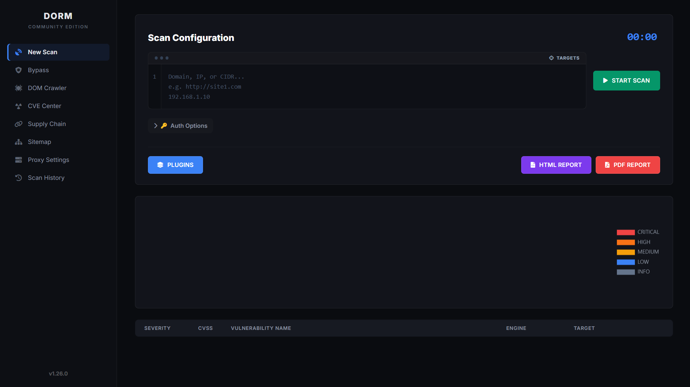

<p align="center">
  
</p>

<p align="center">
  <a href="https://github.com/MrEx-Right/DORM/releases/latest"></a>
  
  <a href="LICENSE"></a>
  
  
</p>

<p align="center">
  <a href="https://github.com/MrEx-Right/DORM/actions/workflows/go-ubuntu.yml"></a>
  <a href="https://github.com/MrEx-Right/DORM/actions/workflows/go-windows.yml"></a>
  <a href="https://github.com/MrEx-Right/DORM/actions/workflows/codeql.yml"></a>
  
</p>

<p align="center">
  <a href="#-key-features"><b>Features</b></a> ·
  <a href="#-architecture"><b>Architecture</b></a> ·
  <a href="#-installation"><b>Installation</b></a> ·
  <a href="#-quick-start"><b>Quick Start</b></a> ·
  <a href="#-plugin-arsenal"><b>Plugins</b></a> ·
  <a href="CHANGELOG.md"><b>Changelog</b></a> ·
  <a href="SECURITY.md"><b>Security</b></a>
</p>

---

**DORM** is a high-performance, concurrent, and modular vulnerability scanner written in **Go**. Designed for Red Teams and Bug Bounty hunters, it combines passive reconnaissance with active, aggressive exploitation techniques.

Unlike traditional scanners, DORM features a hybrid engine that utilizes a **Native DAST Proxy**, a **Smart Spider (Active Fuzzing Engine)**, and an **Offline CVE Database** integration.

<table align="center">
  <tr>
    <td align="center"><h3>103</h3>attack &amp; recon plugins</td>
    <td align="center"><h3>280K+</h3>offline CVE records</td>
  </tr>
</table>

---

## ✨ Dashboard Preview

<p align="center">
  
</p>

<p align="center">
  <i>Enterprise-grade dark dashboard — a clean, corporate control surface with real-time SSE monitoring, multi-target grouping, and persistent history management.</i>
</p>

---

## 🚀 Key Features

### 🔥 Core Engine
- **High Concurrency:** Orchestrates non-blocking scans across multiple targets and IP ranges simultaneously using Go routines.
- **Native Proxy Analyzer:** Built-in HTTP DAST proxy (port 8081) for real-time passive traffic inspection and vulnerability detection.
- **Smart Port Risk Analysis:** Performs deep service classification and framework fingerprinting on alternative ports to identify live dev servers.
- **Dashboard & History Archival:** Real-time web-based UI (SSE) with a dedicated history viewer and HTML/PDF enterprise reporting capabilities.
- **Scan Templates:** Build your own checks from the UI — method, path, severity and `status_code` / `word` / `regex` matchers combined with AND/OR.

### 🧠 Advanced Capabilities
- **🕷️ Smart Spider (Active Fuzzer):** Intelligently crawls, parses HTML forms, extracts API endpoints, and creates a shared intelligence pool for precision payload injections.
- **🕸️ Next-Gen DOM & Reflected XSS Engine:** Tri-phase architecture with advanced WAF-bypassing payload arsenals and line-by-line static DOM taint analysis.
- **📚 NIST CVE Database Engine:** High-performance, zero-latency offline engine powered by `CVEProject/cvelistV5`. Synchronizes a massive repository of 280,000+ vulnerability records locally with intelligent delta updates for lightning-fast product/version correlation.
- **🔥 CISA KEV & EPSS:** Flags CVEs that are known to be exploited in the wild and shows their exploit-prediction score.
- **🔗 Supply Chain Intelligence:** Fingerprints frontend libraries, backend frameworks, CDN and infrastructure on every web target and matches each component against the local CVE database.
- **🗺️ Site Mapper:** Builds a live map of the target from links, JavaScript, `robots.txt` and the DOM crawler.
- **🦎 Chameleon Mode & Evasion:** Dynamic User-Agent rotation, IP obfuscation, and smart jitter rate limiting to bypass WAFs and Firewalls.
- **🎭 Traffic Morph:** A live OpSec panel that shows how DORM looks from the target's side — egress route, measured JA3/JA4 TLS fingerprint, User-Agent persona, and a one-click **NEW IDENTITY** (Tor circuit isolation on SOCKS5).

### 🛡️ Comprehensive Attack Modules
DORM comes equipped with highly advanced, multi-phase plugins:
- **Injection Pipelines:** Omni-SQLi (6-phase), Blind RCE "Phantom Strike" (dynamic WAF bypass), XXE "XML Devil", Next-Gen SSRF (Cloud metadata & DNS rebinding), SSTI, and CRLF.
- **Authentication & Logic:** "Hydra Elite" Brute Force Engine, JWT "Key Breaker" (Algorithm Confusion), Advanced IDOR (Dual-Profile Authorization Matrix), GraphQL Introspection.
- **Cloud & DevOps:** Service exposure detection for MongoDB Wire, Tomcat "Catalina Exploiter" (In-Memory WAR Deployment), Docker API, Kubernetes, Redis, and a Multi-Cloud Storage probe (S3, GCS, Azure Blob, DigitalOcean Spaces, Cloudflare R2) with active anonymous LIST/write verification.
- **AI & LLM Infrastructure:** Dedicated AI/LLM Prompt Injection Scanner plus unauthorized-access detection for exposed AI/vector-DB services — ChromaDB, Qdrant, Milvus, and Ollama.
- **Recon & Secrets:** Webpack Source Map & Secret Harvester (regex + Shannon-entropy scanning of JS bundles and recovered source maps for leaked API keys/tokens), Web Cache Deception, Web Cache Poisoning, 403/401 Authorization Bypass, and HTTP Request Smuggling.

---

## 📦 Installation

DORM requires **Go 1.21+**.

---

### 🐧 Linux / macOS

```bash
# 1. Clone the repository
git clone https://github.com/MrEx-Right/DORM.git
cd DORM

# 2. Download dependencies (single command — no manual go get needed)
go mod download

# 3. Run DORM
go run .
```

---

### 🪟 Windows

**Step 1 — Build** (one-time only):

```bash
git clone https://github.com/MrEx-Right/DORM.git
cd DORM

# Double-click build_windows.bat  — or run it from a terminal:
build_windows.bat
```

The script will:
- ✅ Verify your Go installation (1.21+ required)
- ✅ Download all dependencies via `go mod download`
- ✅ Compile `DORM.exe` in the project folder
- ✅ Terminate any existing `DORM.exe` processes to prevent port conflicts

**Step 2 — Run:**

Double-click `DORM.exe`. A console window opens showing DORM's output. **Close that window to stop DORM.**

> To rebuild (e.g. after pulling updates), run `build_windows.bat` again.

---

## ⚡ Quick Start

1. **Start DORM** — `go run .` (or `DORM.exe`). The dashboard opens in your browser at **http://localhost:8080**.
2. **Add targets** — one or more URLs, hosts or IP ranges.
3. **Pick plugins** — tick the ones you need, or select all of them to run the full arsenal.
4. **Watch it live** — findings stream into the dashboard as they are confirmed, grouped by target and severity.
5. **Export** — download an HTML or PDF report right after the scan, or later from **History**.

> 💡 Point your browser or Burp at the analyzer proxy on **`127.0.0.1:8081`** to have DORM passively inspect your own traffic while you test manually.

---

## ⚔️ Plugin Arsenal

<details>
<summary><b>Show all 103 plugins by category</b></summary>
<br>

| Category | Plugins |
| :-- | :-- |
| 💉 **Injection & RCE** | SQL Injection (Omni-SQLi v5) · NoSQL Injection (Mongo Mayhem v2) · Blind Command Injection (Phantom Strike v3) · SSTI (Template Terminator v3) · XXE Injection (XML Devil v2) · SSRF Omni-Hunter v2 · CRLF Injection · Host Header Injection · LFI · Directory Traversal · Nginx Alias Traversal · Node.js Prototype Pollution · Unrestricted File Upload (RCE) · Java Deserialization Risk · Apache Struts RCE |
| 🕸️ **Client-Side & Web Logic** | XSS (Next-Gen — Reflected & DOM) · DOM XSS & SPA Scanner (Chrome) · Open Redirect · Clickjacking Check · CORS Misconfiguration · WebSocket Hijacking · HTTP Request Smuggling · Web Cache Poisoning · Web Cache Deception · Race Condition |
| 🔑 **Auth & Access Control** | IDOR (Auth Matrix & GraphQL) · BFLA/BOLA · JWT Security Scanner (Key Breaker v3) · Mini-Hydra (SSH/FTP/Telnet/HTTP) · 403/401 Authorization Bypass · Admin Panel Bypass · Admin Panel Finder · IP Spoof — Rate-Limit & WAF Bypass · Cookie Security · GitLab User Enum · WordPress User Disclosure |
| ☁️ **Cloud, DevOps & Services** | Multi-Cloud Storage Exposure · S3 Bucket Detection · Docker API · Docker Registry · Kubernetes Kubelet API · Terraform State · Jenkins Script Console · Tomcat Manager (Catalina Exploiter v3) · Spring Boot Actuator · Redis · MongoDB (Wire Inspector v2) · Memcached · Elasticsearch · Prometheus · Apache Server Status · Anonymous FTP · SMTP Open Relay · WebDAV Methods · ColdFusion |
| 🤖 **AI & LLM** | AI/LLM Prompt Injection · AI/Vector Database Access · MCP Server Exposure · AI Dependency Hallucination (Slopsquatting) |
| 🧩 **Framework Misconfig** | Next.js · NestJS · Express/Node.js · FastAPI · Django · Ruby on Rails · Laravel Debug / Ignition · Laravel .env · Symfony · CodeIgniter · ASP.NET Core · ASP.NET ViewState · PHP Info · WordPress Enumeration & CVE Radar |
| 🔍 **Recon, Secrets & Disclosure** | Webpack Source Map & Secret Harvester · API Key in JS · ENV File · Config.json · Editor/Config Files · Sensitive Backup Files · Git Configuration · DS_Store · Email Disclosure · Open Directory Listing · Shadow API Discovery · Swagger UI · GraphQL Schema · Security.txt · Subdomain Takeover · DORM-BUSTER · CMS & Technology Analysis · WAF Detection |
| 🌐 **Network & Transport** | Open Port Detection · Unnecessary Port Warning · Service & Version Detection · Service Banner Info · SSL Certificate Check · Weak SSL/TLS Protocols · HSTS · Security Headers · Dangerous HTTP Methods · HTTP TRACE Method |
| 📚 **CVE Intelligence** | Offline CVE Radar (Precision Mode) · Exploit-DB Scanner |

</details>

---

## ⚠️ Legal Disclaimer

DORM is built for **authorized security testing only** — penetration tests you have written permission for, bug bounty programs within their scope, and your own systems. Scanning targets without permission is illegal in most countries. The authors accept no liability for misuse or for any damage caused by this tool. **You are responsible for how you use it.**

---

## 🤝 Contributing & Security

- Found a bug or have an idea? [Open an issue](https://github.com/MrEx-Right/DORM/issues) or send a pull request.
- Found a vulnerability **in DORM itself**? Please follow the [Security Policy](SECURITY.md) instead of opening a public issue.
- See the [Changelog](CHANGELOG.md) for what changed in each release.

## 📄 License

DORM is released under the [GNU Affero General Public License v3.0](LICENSE).

---

<p align="center">
  
  <br>
  <sub>If DORM helped you find something, consider leaving a ⭐ — it helps others find it too.</sub>
</p>
